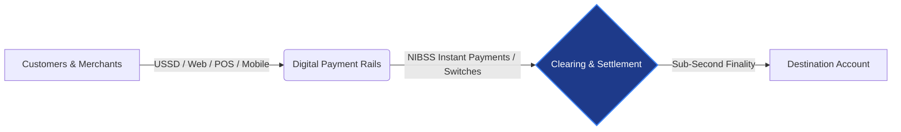
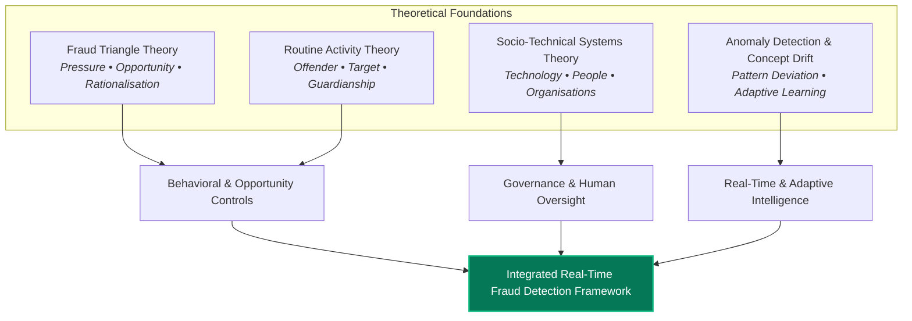
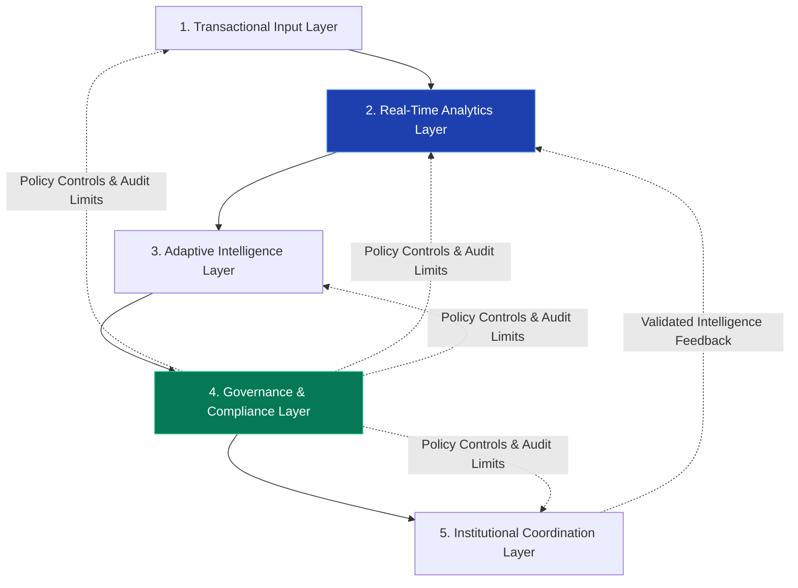
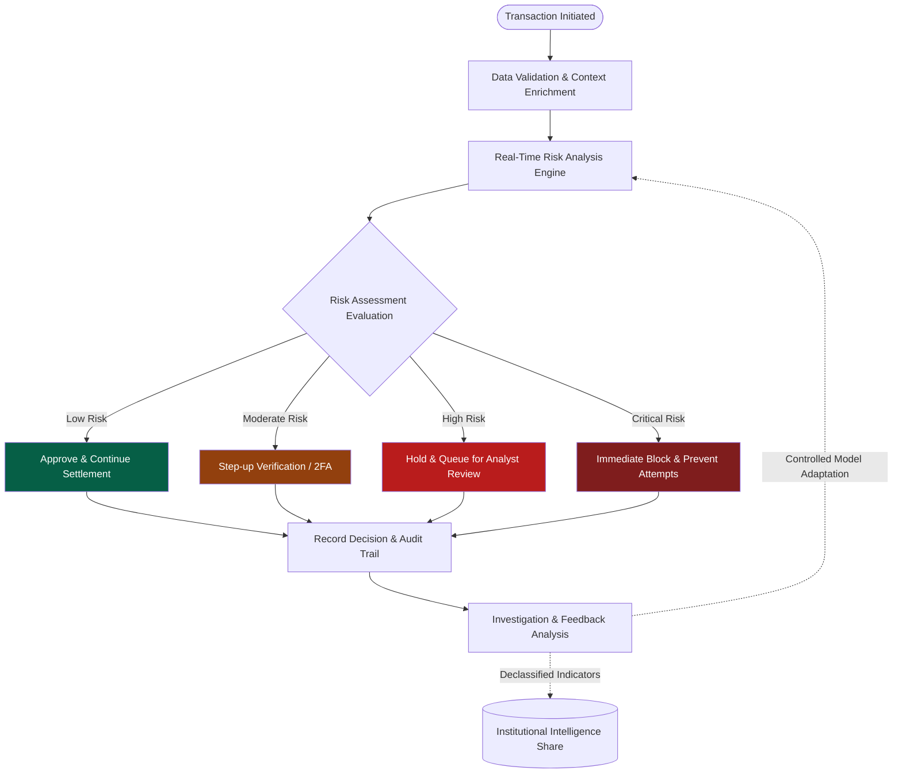
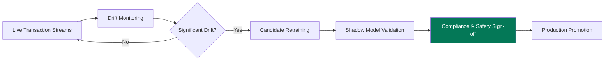
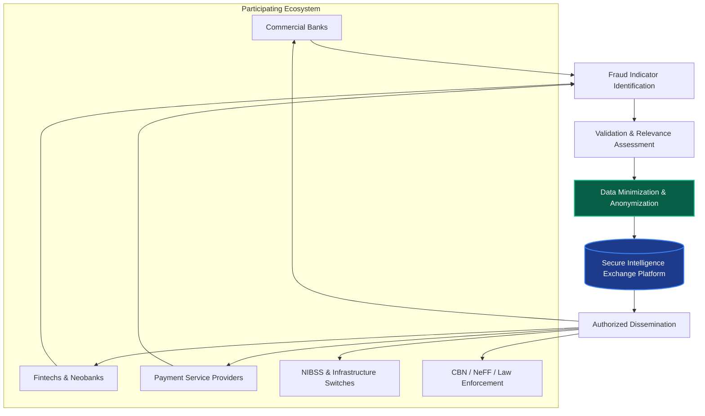

# A Framework for Real-Time Fraud Detection in Nigeria’s Digital Payment Systems
## A Socio-Technical, Adaptive & Governance-Centric Conceptual Model
### Presenter: Mustapha Idris Suleiman
**Academic Defense & Research Seminar**

<!-- note: Good day, esteemed members of the academic committee and chair. Today, I present my research titled "A Framework for Real-Time Fraud Detection in Nigeria's Digital Payment Systems". This study proposes an integrated, five-layer conceptual framework designed to bridge the gap between algorithmic classification, real-time operational execution, explainable governance, and institutional coordination in Nigeria's rapidly evolving payment ecosystem. -->

---

## 1. Context: The Nigerian Digital Payment Revolution
### High Velocity, Massive Volume, and Expanding Attack Surfaces

- **₦1.56 Quadrillion** in electronic transactions recorded in H1 2024 (*CBN E-Payment Statistics*).
- **22.42 Billion** non-cash transactions processed within a 6-month window.
- **Channel Distribution:**
  - **Internet Transfers:** 51.91% of total transaction volume.
  - **Point-of-Sale (POS) & Agency Banking:** 28.53% (critical for financial inclusion).
  - **Mobile Channels & USSD:** 15.58%.
- **The Core Dilemma:** As payment channels diversify and instant settlement becomes ubiquitous via NIBSS Instant Payments (NIP), the window for manual intervention collapses to sub-second durations.



<!-- note: Nigeria represents one of the fastest-growing and most sophisticated instant payment ecosystems globally, driven by NIBSS Instant Payments (NIP) and rapid fintech adoption. However, this velocity introduces significant systemic risk: because funds settle in milliseconds, traditional post-settlement fraud investigation provides little room for loss prevention. Effective intervention must happen before or during authorization. -->

---

## 2. Statement of the Problem
### The Disconnect Between Algorithmic Classification and Operational Reality

1. **Sub-Second Decision Latency:** Machine-learning models with deep inference chains often cannot meet the 200–500ms transaction settlement budget.
2. **Extreme Class Imbalance:** Legitimate transactions exceed fraudulent events by thousands to one, causing fragile models to either suffer high false positives (disrupting legitimate users) or miss complex fraud.
3. **Concept Drift & Evolving Typologies:** Static rule-based systems decay rapidly as fraudsters pivot across account takeover (ATO), SIM swaps, social engineering, and synthetic identities.
4. **Institutional Fragmentation:** Fraud is cross-organizational, but sensitive transaction data cannot be freely pooled due to privacy laws (NDPA 2023) and competitive boundaries.
5. **The Research Gap:** Prior literature treats fraud detection as an isolated mathematical classification problem rather than an end-to-end socio-technical operational lifecycle.

<!-- note: Most academic research focuses almost exclusively on maximizing precision, recall, or F1-scores on isolated, static datasets. In production, however, a model that generates an alert without operational escalation paths, without an auditable explanation, or without inter-bank coordination is an incomplete solution. This study addresses that exact architectural void. -->

---

## 3. Theoretical Foundations
### An Interdisciplinary Triad + Dynamic Pattern Analytics



- **Fraud Triangle Theory (Cressey, 1953):** Explains how gaps in authentication and monitoring create systemic opportunity.
- **Routine Activity Theory (Cohen & Felson, 1979):** Frames fraud detection as capable, distributed guardianship across banks, switches, and regulators.
- **Socio-Technical Systems Theory (Bostrom & Heinen, 1977):** Connects automated AI models with human investigators, compliance officers, and legal processes.

<!-- note: Rather than relying on a single theoretical lens, we combine three established criminological and organizational theories with the mathematical realities of anomaly detection and concept drift. This grounds our technical architecture in proven behavioral and systemic science. -->

---

## 4. The Proposed Architecture: Five Interconnected Layers
### A Unified, Technology-Agnostic Model

| Layer | Functional Domain | Primary Responsibility |
| :--- | :--- | :--- |
| **1. Transactional Input** | Contextual Ingestion | Ingests, validates, and enriches transaction metadata (device, IP, geo, historical baseline). |
| **2. Real-Time Analytics** | Multi-Signal Scoring | Evaluates composite risk in real-time using rules, anomaly scoring, and machine learning. |
| **3. Adaptive Intelligence** | Dynamic Learning | Tracks concept drift, monitors model degradation, and ingests verified feedback. |
| **4. Governance & Compliance** | Auditability & XAI | Generates human-understandable explanations (XAI) and immutable audit records under NDPA 2023. |
| **5. Institutional Coordination** | Multi-Bank Collaboration | Facilitates secure, privacy-preserving sharing of fraud intelligence across Nigeria's ecosystem. |



<!-- note: Here is the core contribution of the study. Notice that this is not a one-way conveyor belt. The layers form a closed-loop socio-technical system. Layer 4 governs all operations, while Layer 5 brings external intelligence back into Layer 2 to continuously strengthen the system against emerging fraud syndicates. -->

---

## 5. Layer 2: Multi-Signal Real-Time Risk Engine
### Composite Risk Formulation Beyond Isolated Heuristics

$$R = f(T, B, C, A, G)$$

- **$T$ (Transaction Characteristics):** Amount, channel, velocity, recipient category, payment instrument.
- **$B$ (Behavioral Baseline):** Deviation from personal historical spending patterns, active hours, and typical counterparties.
- **$C$ (Contextual Telemetry):** Device fingerprint, IP reputation, geolocation mismatch, SIM-swap indicator.
- **$A$ (Analytical Engine):** Real-time rule thresholds, unsupervised anomaly scores, and supervised model inference.
- **$G$ (Global Institutional Intelligence):** Cross-institutional watchlists, flagged accounts, and syndicated fraud typologies.

#### Decision Thresholding Matrix:
1. **Low Risk:** Automated Approval ($< 200\text{ms}$).
2. **Moderate Risk:** Supplemental Verification (Step-up 2FA, biometric re-auth).
3. **High Risk:** Transaction Held / Flagged for expedited human analyst review.
4. **Critical Risk:** Immediate Block & security notification under pre-authorized policy.

<!-- note: The risk relationship R = f(T, B, C, A, G) formally demonstrates that fraud risk is multidimensional. An isolated transaction of 100,000 Naira might look completely normal on its own, but becomes immediately suspicious when combined with a novel device ID, an uncharacteristic 3 AM timestamp, and a destination account newly flagged by another institution. -->

---

## 6. End-to-End Operational Decision Flow
### Balancing Immediate Sub-Second Settlement with Governance



<!-- note: Walk the committee through this flow: The top branch represents the sub-second decision path, executing within milliseconds to ensure legitimate payment velocity is never compromised. The bottom branch represents the asynchronous governance and feedback path, ensuring accountability and long-term learning without adding latency to the live payment rail. -->

---

## 7. Explainable AI (XAI) & Auditability Card
### Bridging Machine Intelligence and Regulatory Scrutiny

```
┌────────────────────────────────────────────────────────────────────────┐
│ FRAUD INVESTIGATION & AUDIT RECORD #NIP-2026-88492                     │
├────────────────────────────────────────────────────────────────────────┤
│ Transaction: ₦450,000.00 | Channel: Mobile App (Transfer)              │
│ Timestamp: 2026-11-10 02:14:18 WAT | Decision: FLAGGED (High Risk: 0.89) │
├────────────────────────────────────────────────────────────────────────┤
│ EXPLAINABILITY ATTRIBUTION (Top Contributing Factors):                 │
│  [+] Unrecognized Device ID (First-time fingerprint)    ──> +34% Risk  │
│  [+] Rapid Velocity Spike (3rd high-value in 10 mins)   ──> +28% Risk  │
│  [+] High-Risk Destination Account (Dormant 180+ days)  ──> +21% Risk  │
│  [-] Geolocation consistent with recent cell tower      ──> -08% Risk  │
├────────────────────────────────────────────────────────────────────────┤
│ GOVERNANCE & AUDIT META:                                               │
│ Model: Ensemble-XAI-v4.2 | Threshold Set: 2026-Q4-v2                   │
│ Action: Referred to Tier-2 Fraud Desk | Status: Under Review           │
│ Compliance Alignment: NDPA 2023 §24 • CBN AML/CFT/CPF 2026 Guidelines │
└────────────────────────────────────────────────────────────────────────┘
```

- **Explainability:** Answers *“Why was this specific payment flagged?”* for analysts and customers.
- **Auditability:** Answers *“Under what model version, rules, and telemetry was this decision taken?”* for CBN auditors and court disputes.

<!-- note: In high-stakes financial operations, a black-box probability score of 0.89 is useless to a human investigator or a court of law. Layer 4 generates intuitive feature attribution (inspired by SHAP values and user-centered XAI principles) alongside an immutable audit trail. This satisfies the strict accountability standards of the Nigeria Data Protection Act 2023 and CBN's 2026 AML/CFT guidelines. -->

---

## 8. Adaptive Intelligence & Concept Drift
### Controlled Adaptation Without Model Poisoning

- **The Danger of Uncontrolled Retraining:** If automated models retrain directly on incoming live streams without validation, adversarial fraudsters can gradually "poison" baseline thresholds.
- **The Governed 4-Stage Adaptive Loop:**
  1. **Drift Detection:** Statistical divergence tests (e.g., KS-test, PSI) detect distribution shifts in payment amounts and frequencies.
  2. **Human-in-the-Loop Validation:** Alerts confirmed as genuine fraud or legitimate spending by investigators are curated into clean training datasets.
  3. **Offline Shadow Evaluation:** Retrained candidate models run in shadow mode alongside production without executing live actions.
  4. **Staged Deployment:** Approved candidate models are versioned, documented in Layer 4, and safely deployed.



<!-- note: Concept drift is unavoidable in Nigerian payments due to rapid lifestyle changes, seasonal spending spikes, and evolving fraud schemes. Our framework explicitly mandates controlled, audited retraining rather than open-ended online learning, preventing automated decision models from degrading or being manipulated by coordinated attacks. -->

---

## 9. Layer 5: Institutional Fraud Intelligence Sharing
### Transforming Isolated Victims into an Immunized Ecosystem



- **Core Rule:** **Never share raw PII or banking histories.**
- **Shared Artifacts:** Cryptographic hashes of compromised device fingerprints, known mule account networks, malicious IP clusters, and novel crime scripts.
- **Institutional Hub:** Aligned with the statutory mission of the **Nigeria Electronic Fraud Forum (NeFF)** and NIBSS switching intelligence.

<!-- note: A fraudster who successfully exploits a vulnerability at Bank A will frequently move immediately to Fintech B and PSP C. By implementing privacy-preserving threat intelligence exchange, an attack detected at one node can inoculate every participating institution within minutes, without violating consumer data privacy laws. -->

---

## 10. Scenario Walkthrough: Testing the Framework
### Demonstrating Coherent Multi-Scenario Resilience

| Operational Scenario | Analytical Signal | Proposed System Action | Feedback / Systemic Result |
| :--- | :--- | :--- | :--- |
| **A: Routine Grocery Spend** | Verified customer device, typical hour, normal amount (₦12,500). | **Instant Approval** ($<150\text{ms}$). | Logged to Layer 4 audit repository. |
| **B: Traveling Customer** | Known device, but novel geolocation (e.g., Lagos customer transacting in Abuja). | **Supplemental Verification** (Biometric prompt on banking app). | Legitimate authentication confirms context; prevents false decline. |
| **C: Credential Theft & Takeover** | Midnight transaction, foreign IP, new device, maximum account drainage attempt. | **Immediate Block** under Critical Risk policy. | Account protected; security dispatch alerted; customer notified. |
| **D: Coordinated Multi-Bank Mule Ring** | Multiple new accounts across 3 fintechs receiving rapid micro-transfers. | Inter-institutional correlation flags emerging network topology. | Layer 5 issues sanitized IOC alert to NeFF; mule network frozen across all rails. |

<!-- note: These four scenarios demonstrate how the five layers function in practice. The framework avoids the blunt instrument of binary approve/deny by introducing contextual verification for moderate risks, while coordinating multi-institutional defenses when systemic attacks are detected. -->

---

## 11. Strategic Recommendations for Key Stakeholders
### Actionable Guidelines for Nigeria’s Digital Financial Ecosystem

- **For the Central Bank of Nigeria (CBN):**
  - Establish binding regulatory guidelines for Explainable AI (XAI) and decision auditability in automated financial crime tools.
  - Expand NeFF's mandate to support automated, machine-readable fraud intelligence exchanges.
- **For Commercial Banks & Fintechs:**
  - Transition from standalone rule engines to hybrid, multi-signal architectures ($R = f(T,B,C,A,G)$).
  - Implement dual-track architectures separating real-time scoring latency from asynchronous model retraining.
- **For NIBSS & Payment Infrastructure Operators:**
  - Build privacy-preserving intelligence APIs to feed centralized risk signals into real-time clearing streams.
  - Establish industry-wide baseline telemetry for identifying multi-institution mule routing.

<!-- note: Our recommendations translate theoretical findings into concrete policy and operational roadmaps for Nigeria's financial regulators, commercial lenders, fintech neobanks, and central switching operators. -->

---

## 12. Conclusion & Future Research Roadmap
### From Conceptual Synthesis to Empirical Implementation

- **Main Thesis Conclusion:** Real-time fraud detection in modern digital payments cannot be solved by classification algorithms alone; it requires an integrated socio-technical architecture uniting analytics, explainability, human governance, and institutional collaboration.
- **Future 6-Phase Empirical Roadmap:**
  - *Phase 1:* Institutional Requirements Assessment & Legal Data Agreements.
  - *Phase 2:* Microservice Specification & Low-Latency API Architecture.
  - *Phase 3:* Prototype Deployment in an Isolated Testbed.
  - *Phase 4:* Empirical Benchmarking (Precision, Recall, Latency, F1 under imbalanced data).
  - *Phase 5:* Governance & NDPA 2023 Compliance Audits.
  - *Phase 6:* Live Operational Pilot with Participating Payment Operators.

### Thank you! Questions & Discussion Welcome.

<!-- note: In conclusion, this research provides an algorithm-agnostic, Nigerian-contextualized framework designed for longevity and empirical testability. Thank you very much for your time and guidance. I now welcome the questions and comments of the committee. -->
